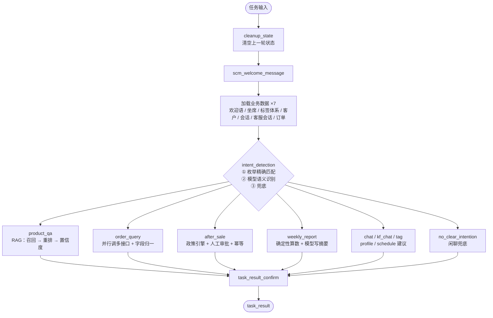
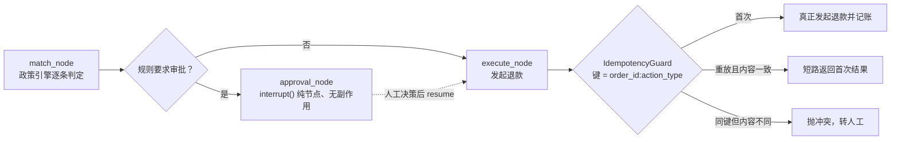

# 电商智能客服与运营助手

**基于 LangGraph 的多链路客服智能体**：一个统一调度主图 + 10 条业务链路，覆盖商品咨询
（RAG 有据回答）、订单查询（多 API 编排 + 字段归一）、售后处理（政策引擎 + 人工审批 +
幂等）、运营周报、以及坐席话术／标签／画像／日程建议。

```bash
git clone <repo-url> ecom-cs-agent && cd ecom-cs-agent
uv sync --project scm_agent                              # 装依赖（需要 uv；这一步要联网）
uv run --project scm_agent python quickstart.py          # 13 个场景一次跑完
```

跑 demo 本身**不需要 API Key、不需要数据库、不需要起任何服务，也全程不联网**。
想要交互式地一步步走（遇到审批时停下来问你）：

```bash
uv run --project scm_agent python quickstart.py                    # 交互模式
uv run --project scm_agent python quickstart.py --list             # 看全部 13 个场景
uv run --project scm_agent python quickstart.py -s order           # 只跑订单联合查询
uv run --project scm_agent python quickstart.py --gateway mcp      # 工具调用改走 MCP 网关（结果应与默认一致）
```

> **关于这份仓库的定位**：它不是生产代码，而是把我在工作中做过的同类系统（企业微信客服
> 助手 + 运营后台）的业务架构抽取出来、重写成一个**个人可运行 demo**。所有外部依赖 ——
> 大模型、订单／物流／库存系统、企业微信 —— 都有内置的离线替代实现，所以 `git clone`
> 之后第一条命令就能跑通全链路；同时也保留了 `LLM_MODE=live` 接真实模型的开关。
> 演示数据全部虚构。

---

## 一、它长什么样

`python quickstart.py -s aftersale_approval` 的真实输出（节选）：

```text
  场景：售后处理（高金额人工审批）
  输入：'订单 SO20260320008 的落地灯灯臂磕碰了，我要退货退款'

  执行过程：
  · 加载业务数据：欢迎语
  · 加载业务数据：坐席信息
  · 加载业务数据：标签体系
  · 加载业务数据：客户信息与画像
  · 加载业务数据：会话记录
  · 加载业务数据：客服会话
  · 加载业务数据：订单记录
  · 意图识别：枚举精确匹配 → 语义识别 → 兜底
  · 售后政策匹配：✓ 售后原因命中关键词：磕碰、磕
  · 售后政策匹配：✓ 实付金额 599.00 元 ≥ 500.00 元
  · 售后政策匹配：✓ 签收后第 1 天 ≤ 7 天
  · 售后政策匹配：✓ 订单状态 400(已签收) 属于 ['300', '400']
  · 售后政策匹配：✗ POL-REJECT-DUPLICATE 重复售后申请：订单状态 400 不属于 ['600', '700']
  · 售后政策匹配：✗ POL-HANDOFF-EXPIRED 超出售后时效：签收后第 1 天 < 30 天
  · 完成：POL-REFUND-BROKEN-HIGH -> auto_refund
  · 等待人工确认：破损包赔（高金额，需审批）：599.00 元待审批

  ⏸  等待人工审批：订单 SO20260320008 需退款 599.00 元，超过自动处理额度，请确认是否执行
  → 非交互模式，自动确认（ok）

  审批后过程：
  · 售后政策匹配：审批通过：0e7330a807c057a4
  · 退款已提交：全额退款已提交，单号 RF-0279A8AC59
  · 结果确认
```

几个值得注意的地方：

* 政策匹配**逐条打印判定依据**（`✓/✗` 每一行都是某条规则的某个条件），命中哪条、
  为什么没命中另外几条，一眼可查 —— 出问题时不用猜。
* 审批中断发生在**执行之前**，退款由独立节点发起；同一条诉求再提交一次会命中幂等记录
  短路返回（`-s aftersale_replay`），不会退第二笔钱。
* 全过程不联网：模型是内置的离线合成器，订单／物流／库存读的是 `data/seed/*.json`。

---

## 二、能力矩阵

| 简历里的说法 | 在代码里落在哪 | 怎么验证 |
|---|---|---|
| 统一调度 + 业务链路解耦 | `scm_graph.py` 主图：7 个数据装载节点 → 意图路由 → 10 个业务子图 → 结果确认，子图以节点形式挂载 | `quickstart.py` 任意场景 |
| 统一状态模型 + 自定义 reducer | `scm_state.py` 承载商品／订单／售后／会话多源数据；`reducer_node_result` 累积执行轨迹 | 每场景末尾的「执行轨迹」 |
| 意图识别「枚举 + 语义」两层 | `scm_node.py: intent_detection`：枚举精确匹配直达 → 模型语义识别 → 兜底通用问答 | `-s qa`（枚举）／`-s qa_miss`（语义）／`-s talk`（兜底） |
| 商品知识库 RAG | `rag/`：解析 → 语义分块 → 向量化 → 混合召回 → 重排 → **置信度 → 转人工兜底**，回答带出处页脚 | `-s qa` 命中；`-s qa_miss` 资料未覆盖 → 转人工 |
| 订单查询多 API 编排 | `sub_order_query`：`ThreadPoolExecutor` 并行拉订单／物流／库存，部分失败标 `degraded` 不整体失败 | `-s order`（含归一轨迹）；`-s order_degraded` |
| 「模型只负责转述」硬约束 | `verify_no_new_numbers()`：回答里每个数字都必须在确定性事实单里出现过，否则丢弃模型输出回退事实转述 | `-s order`、`-s report` |
| 售后政策引擎 + HITL + 幂等 | `integrations/policy.py` 全条件 AND + 优先级；高金额走 `interrupt()` 人工审批；`IdempotencyGuard` 保证退款不重复 | `-s aftersale`／`aftersale_approval`／`aftersale_replay` |
| 数据周报（取数／算数／说话分离） | `sub_weekly_report`：指标与同环比由确定性代码算，模型只写摘要与异常提示 | `-s report` |
| FastAPI + Pydantic + SSE | `webapp/chat_routes.py`：`/scm/chat/stream`、`/scm/chat/resume`、`/scm/state/{thread_id}` 等 5 个接口 | 见「服务模式」一节 |
| MCP 工具网关 | `mcp_server/`（stdio）暴露 7 个业务工具；`TOOL_GATEWAY=direct\|mcp` 一键切换 | `--gateway mcp` 全场景 13/13 |
| JWT + 可观测 | 坐席登录按用户签发 JWT（非静态令牌）；`observability/progress.py` 统一进度事件，Langfuse 可选接入 | 坐席工作台（见「服务模式」） |

---

## 三、架构

### 主图：统一调度，子图各自闭环



7 个数据装载节点是**串行**的，每步只负责汇入自己那一份数据（这是「统一状态模型汇多源
数据」的落点：一次会话开始时，客户、标签体系、历史会话、订单全部就位，后续任何链路都
不必再各自查一遍）。子图通过 `Command(goto=...)` 直达，上下文靠父图状态传递。

### 售后链路：中断点前后的分工是硬约束



`interrupt()` 所在节点在 resume 时会**从第一行重放**，所以有副作用的代码绝不能放在
中断之前 —— 这一条是结构上的保证，不依赖 guard 是否写对。冲突（同订单同动作但金额／
原因变了）不静默复用也不重复执行，而是抛出来转人工：那本身就是要人来判的信号。

### 工具调用有两条路径


两条路径共用同一份字段归一（`integrations/normalize.py`），所以切换网关不改变业务
结果 —— `--gateway mcp` 与默认模式跑同一套 13 场景，输出一致。

---

## 四、四个做深的地方（面试可追问的点）

### 1. 置信度阈值要能「固定」，重排分就必须是绝对分

检索链路（`rag/`）的置信度 = `0.65 × top1 + 0.20 × margin + 0.15 × 诉求词覆盖率`。
其中重排分用 `x/(x+3)` 压到 `[0,1)` 的**绝对分**，而不是按查询做 min-max 归一化：
归一化会让任何查询的 top1 恒等于 1.0，固定阈值随之失效，「低于阈值就转人工」这条
兜底永远不会触发 —— 它坏得很安静。同理，覆盖率的分母用**原始查询**而不是扩展后的
查询（扩展词是人为注入的，算进去会虚高）。

诉求词覆盖率只有「等于 0」一条判负线，阈值刻意不可调：实测可回答问题最低 0.19、
越界问题最高 0.33，区间重叠，卡任何值都会误伤正常长句。需要让某类问题能被答上时，
往同义词表 `rag/expansion.py` 补一条即可，不用改算法 —— 这张表就是那条判负线的安全阀。

### 2. 「模型只负责转述」是一条可执行的约束，不是一句原则

订单与周报链路里，所有数字先由确定性代码算成一份**事实单**，再交给模型组织语言。
`verify_no_new_numbers(answer, facts_block)` 逐数字校验模型输出：任何没在事实单里
出现过的数字，都判定为编造，整段丢弃并回退为事实模板转述。周报同理 —— 摘要里提到
的每个数字都必须能在指标表里找到。

### 3. 离线模式不是「返回一句假话」，而是同样有据可查

`llm/llm_setting.py` 是真实模型与离线模型的唯一切换点，7 个调用方零改动。离线合成器
（`llm/offline/synth_ops.py`）**数据驱动**：从提示词里取业务数据、用词表与正则找证据、
把证据原文写进 `reason`；话术建议会真的走一遍 RAG 检索再套模板。所以离线态的回答
依然带出处、依然会因为「资料里没有」而转人工 —— 它经得起换一句对话再跑。

> 判断「当前是不是离线」要用 `is_offline_model()` 看实例，不要读 `LLM_MODE` 环境
> 变量：填了 live 但缺配置会自动回落离线，这时环境变量是说反的。

### 4. 进度事件的兜底：不为「漏写一行」买单

坐席工作台的时间线要显示链路走到哪一步。节点里手写的 `emit()` 只是来源之一 ——
10 条链路里一度只有 4 条写了，另外 6 条在前端就是**一片空白**。修法不是在 6 个子图里
逐个补（漏一个还是空的），而是在 runner 消费 `updates` 通道时按 `NODE_EVENTS` 表兜底：
节点跑过但没 emit 任何东西，就补一条业务步骤。想加一条链路的时间线，先看那张表，
而不是只 grep `emit(`。

---

## 五、目录结构

```text
ecom-cs-agent/
├── quickstart.py              # 零配置演示入口：不启服务、不联网，13 个场景
├── scm_agent/                  # 核心：LangGraph 智能体服务（约 1.5 万行）
│   ├── src/graphs/scm_graph/   #   主图 + 10 个业务子图（每个子图 = graph/state/node 三件套）
│   ├── src/rag/               #   解析 / 分块 / 向量化 / 混合召回 / 重排 / 置信度 / 出处
│   ├── src/llm/               #   提示词 + provider（real / offline）+ offline/ 合成器
│   ├── src/integrations/      #   ports + mock/http 适配器 + 字段归一 + 政策引擎 + 幂等 + MCP 桥
│   ├── src/webapp/            #   FastAPI：SSE 对话接口 + JWT + 坐席工作台静态页
│   ├── src/demo/              #   场景表 + 进程内 runner（与 webapp 共用同一套进度事件）
│   ├── data/seed/             #   虚构的种子数据（商品/订单/物流/库存/客户/政策/标签）
│   └── data/knowledge/        #   RAG 语料：FAQ + 售后总则 + 物流发票 + 会员权益
├── mcp_server/                # MCP 工具网关（stdio，7 个业务工具）
├── scm_admin/                  # Flask 运营后台：客户／订单／客服会话／标签等页面
├── scm_client/                 # 客户端 SDK 与端到端脚本（打真实平台服务用）
├── docs/architecture.md       # 架构细节与关键取舍
└── scm_agent/tests/            # pytest 套件 + 前端时间线的 node 回归脚本
```

---

## 六、场景一览

`python quickstart.py --list` 的完整列表：

| key | 场景 | 看点 |
|---|---|---|
| `qa` | 商品咨询问答 | 回答带出处页脚 |
| `qa_miss` | 商品咨询（知识库未覆盖） | 置信度不足 → 转人工，而不是硬编答案 |
| `order` | 订单联合查询 | 订单／物流／库存并行，逐条打印字段归一映射 |
| `order_degraded` | 订单查询（物流接口故障） | 部分失败不整体失败，缺的那路如实告知 |
| `aftersale` | 售后（低金额自动退款） | 政策引擎逐条判定依据 |
| `aftersale_replay` | 售后重复提交 | 幂等短路，不产生第二个退款单号 |
| `aftersale_approval` | 售后（高金额人工审批） | `interrupt` → 审批 → 独立节点执行退款 |
| `report` | 运营数据周报 | 取数／算数／说话三段分离 |
| `tag` | 生成客户标签 | 建议 → 人工审批（可确认／放弃／重新生成） |
| `profile` | 生成客户画像 | 从对话与订单抽取画像项 |
| `schedule` | 创建跟进日程 | 生成跟进建议 |
| `chat` | 坐席话术建议 | 结合历史对话生成回复建议 |
| `talk` | 闲聊兜底 | 说明能力边界 |

---

## 七、服务模式（可选）

上面所有能力都在进程内可跑；以下是把同一套代码当服务跑的方式，用于演示 SSE 流式
进度、人工审批流转与运营后台。

```bash
# 1) 起 LangGraph 平台服务（:2024，自动装配 webapp 的 /scm/* 路由）
cd scm_agent && ./run_scm_agent

# 2) 坐席工作台（对话 + 实时进度时间线 + 审批卡片 + 结果卡片）
#    http://127.0.0.1:2024/scm/workbench/     ← 账号取 scm_agent/.env 的 DEMO_USER_*

# 3) 运营后台（Flask，:5000；读平台里的 Store，必须先起 1）
cd scm_admin && ./run_scm_admin
```

工作台的执行过程时间线会折叠连续的同名阶段（如订单链路 36 步里有 24 步是字段归一，
折成一行「字段归一 ×24」，点开看逐条），行数与步数都标出来。

客户端 SDK 与端到端脚本在 `scm_client/`（连的是上述平台服务，不是离线 quickstart）。
脚本之间是同目录相互 import，所以**要进到那个目录里跑**：

```bash
cd scm_client/store_client && uv run python scm_demo_init.py        # 灌演示数据
cd scm_client/agent_client && uv run python scm_agent_test.py test  # 跑一轮对话
```

---

## 八、测试

```bash
uv run --project scm_agent python -m pytest scm_agent/tests -q   # 后端：检索阈值 / 归一 / 政策 / 幂等 / 合成器 schema / 路由 / HITL 恢复
node scm_agent/tests/frontend/timeline_check.mjs                 # 前端：时间线折叠逻辑（DOM 桩）
uv run --project scm_agent python quickstart.py --yes            # 端到端：13/13
```

`scm_admin/` 与 `scm_client/` 各自有独立的 `pyproject.toml` 与 `uv.lock`，用 `uv sync` 安装。

---

## 九、技术选型说明

* **为什么检索是纯 Python 字符 n-gram**：demo 要「clone 下来就能跑」。默认实现零第三方
  依赖、零索引构建等待；`VECTOR_STORE=milvus` 时懒加载 `pymilvus` 切到向量库，两条
  路径共用同一套召回/重排/置信度接口。检索索引与语料都在 `data/` 下，可增量重建。
* **为什么保留 MCP 网关**：它演示的是「业务节点不直接依赖具体工具实现」。工具定义在
  `mcp_server/`，业务侧只认 `ports.py` 的 Protocol —— 这在需要把工具收敛到统一网关上
  做鉴权/审计/限流时是刚需。direct 与 mcp 两条路径跑同一套场景，结果一致。
* **为什么用 `InMemorySaver` 而不是平台运行时**：离线演示不需要数据库。`quickstart.py`
  用 `InMemorySaver` + `InMemoryStore` 在进程内跑完「发起 → 中断 → 恢复」全过程，
  与平台服务共用同一套图与同一套进度事件。
* **为什么 HITL 用 `interrupt()` 而不是回调**：状态检查点天然支持「中断后进程重启再
  恢复」，审批人不必和发起人在同一个进程里。
* **依赖里有一条 `override-dependencies`**：`langgraph-api` 的元数据把
  `sse-starlette` 钉在 `<2.2.0`，与 `mcp>=2.0` 要求的 `>=3.0.0` 按元数据无解。实测两者
  在运行时共存无碍（`langgraph dev` 正常起、MCP 两条路径 13/13），所以显式覆盖那条
  陈旧的 pin，理由写在 `scm_agent/pyproject.toml` 里。

---

## 十、边界（先说清楚）

* **数据全部虚构**：商品、订单、客户、会话记录都是 `data/seed/*.json` 里的构造数据，
  时间戳按「相对今天」生成，保证周报的「本周」永远新鲜。
* **离线合成器不是大模型**：它按业务规则合成结构化输出，用于让 demo 离线可跑、
  可复现。接真实模型请配 `LLM_MODE=live` 与 API Key，调用方代码零改动。
* **`scm_admin` 与 `scm_client` 是配套演示**，未做权限体系的完整实现；`mcp_server` 的
  工具直接读 mock 数据源。两个模块各自持有一份 Store 客户端，`scm_client` 那份是
  超集（多出灌数据用的写接口），没有抽公共包 —— 它们本就是「怎么连平台」的示例，
  抽出去反而多一层。
* **没做的**：多租户、限流、审计日志落库、真实的支付/退款对接 —— 这些属于生产系统
  的范畴，不在个人 demo 的射程内。
