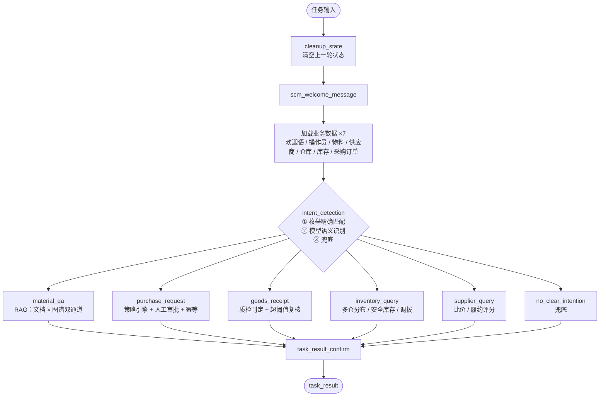
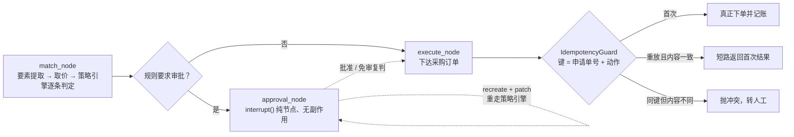
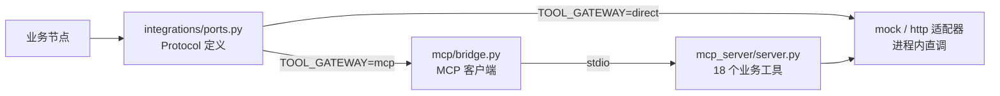

# 供应链采购仓储智能系统

**基于 LangGraph 的业务智能体**：一个统一调度主图 + 5 条业务链路（智能问答、采购申请、
收货验收、库存管理、供应商管理）+ 1 条兜底，覆盖制度问答（RAG 双通道：制度文档 ×
物料-供应商-仓库图谱）、采购审批（策略引擎 + 人工审批 + 幂等）、质检复核、库存预警
与调拨建议、供应商比价与履约评分。

```bash
git clone <repo-url> && cd <repo>/scm-agent
uv sync --project scm_agent                              # 装依赖（需要 uv；这一步要联网）
uv run --project scm_agent python quickstart.py --yes    # 17 个场景一次跑完
```

跑 demo 本身**不需要 API Key、不需要数据库、不需要起任何服务，也全程不联网**。
想要交互式地一步步走（遇到审批时停下来问你）：

```bash
uv run --project scm_agent python quickstart.py                    # 交互模式
uv run --project scm_agent python quickstart.py --list             # 看全部 17 个场景
uv run --project scm_agent python quickstart.py -s purchase_approval   # 只跑采购审批
uv run --project scm_agent python quickstart.py --gateway mcp      # 工具调用改走 MCP 网关
```

> **关于这份仓库的定位**：它不是生产代码，而是把我在实习中参与过的同类系统
> （供应链采购仓储的智能助手 + 审批后台）的**架构抽取出来、重写成一个个人可运行
> demo**。所有外部依赖 —— 大模型、ERP／SRM／WMS 业务系统、图谱数据库 —— 都有内置的
> 离线替代实现，所以 `git clone` 之后第一条命令就能跑通全链路；同时也保留了
> `LLM_MODE=live` 接真实模型、`GRAPH_STORE=neo4j` 接真实图库的开关。
> 演示数据全部虚构。

---

## 一、它长什么样

`python quickstart.py -s purchase_approval` 的真实输出（节选）：

```text
  场景：采购申请（新供应商转人工审批）  [purchase_approval]  （TOOL_GATEWAY=direct）
  输入：'给 WH01 申购 8000kg 冷轧钢板 1.2mm，指定 S012，产线急用'

  执行过程：
  · 加载业务数据：欢迎语 / 操作员信息 / 物料主数据 / 供应商主数据 / 仓库主数据 / 库存快照 / 采购订单
  · 意图识别：枚举精确匹配 → 语义识别 → 兜底
  · 采购策略匹配：正准备提取采购申请要素
  · 采购策略匹配：✓ 按申请指定供应商 华东新材科技股份有限公司（S012），报价 5.60 元/kg
  · 采购策略匹配：✓ 供应商 华东新材科技股份有限公司 是新供应商，符合「新供应商」要求
  · 采购策略匹配：✗ PUR-001 大额采购需主管审批：申请金额 44800.00 元 < 50000.00 元
  · 完成：PR202610128EDEF0 amount=44800.00 policy=PUR-002 approval=True
  · 等待人工确认：冷轧钢板 1.2mm：44800.00 元待审批

  ⏸  等待人工审批：新供应商首单需审批：冷轧钢板 1.2mm（M100023）8000kg，金额 44800.00 元
      方案 b1b747a4c052596b  申请单 PR202610128EDEF0
      冷轧钢板 1.2mm（M100023）  8000.0kg × 5.6 元 = 44800.0 元
      到货仓 WH01  预计到货 2026-10-22
      ✓ 按申请指定供应商 华东新材科技股份有限公司（S012），报价 5.60 元/kg
      ✓ 供应商 华东新材科技股份有限公司 是新供应商，符合「新供应商」要求
      ✗ PUR-001 大额采购需主管审批：申请金额 44800.00 元 < 50000.00 元
  → 非交互模式，自动确认（ok）

  审批后过程：
  · 采购策略匹配：审批通过：b1b747a4c052596b
  · 采购订单已下达：采购订单已下达（PO2026101246215）

  最终结果：【新供应商首单需审批】采购订单已下达（单号 PO2026101246215），预计 2026-10-22 到货。
  申请单号：PR202610128EDEF0
```

几个值得注意的地方：

* 策略匹配**逐条打印判定依据**：命中的条件 `✓`、被跳过的高优条款 `✗`（附 policy_id），
  为什么走审批、为什么没命中旁路的免审条款，一眼可查。
* 审批中断发生在**执行之前**，采购订单由独立的执行节点下达；同一条诉求再提交一次会
  命中幂等记录短路返回（`-s purchase_replay`），不会下出第二张单。
* 「不通过」不是终点：`recreate` 可以带着**只改某几个字段**的 patch 重走策略引擎
  （`-s purchase_recreate` 把供应商改成 S001 → 复判免审 → 直接下单），这条路径正是
  「一次通过率」指标背后的机制。
* 全程不联网：模型是内置的离线合成器，物料／供应商／库存／采购单读的是 `data/seed/*.json`。

---

## 二、能力矩阵

| 能力 | 在代码里落在哪 | 怎么验证 |
|---|---|---|
| 统一调度 + 能力解耦 | `scm_graph.py` 主图：7 路数据装载 → 意图路由 → 6 个子图 → 结果确认，子图以节点形式挂载 | `quickstart.py` 任意场景 |
| 统一状态模型 + 自定义 reducer | `scm_state.py` 汇多源数据；`reducer_node_result` 累积执行轨迹 | 每场景末尾的「执行轨迹」 |
| 意图识别三层（枚举 → 语义 → 兜底） | `scm_node.py`：6 个菜单 id 枚举直达 → 模型语义识别 → 兜底子图 | `-s inventory_query`（枚举）／`-s qa_miss`（语义）／`-s talk`（兜底） |
| 制度问答 RAG + 图谱双通道 | `rag/` + `kg/`：关系类问题额外召回图谱事实，三路 RRF 融合；回答带出处，置信度不足 → 转人工 | `-s material_qa`（DOC）／`-s material_qa_relation`（RELATION）／`-s qa_miss`（转人工） |
| 图谱多跳查询 | `kg/query.py`：替代料推荐、供应商比价、多仓库存分布；图事实整句照抄进答案 | `-s material_qa_relation`／`inventory_low`／`supplier_compare` |
| 采购策略引擎 | `integrations/policy.py`：全条件 AND + 优先级降序首命中；6 类条件检查 | `-s purchase_auto`（免审）／`purchase_approval`（审批） |
| HITL 人工审批 + 幂等 | `interrupt()` 中断在前、执行在后；`IdempotencyGuard` 保证不重复下单 | `-s purchase_replay`／`-s receipt_quality` |
| 「驳回带修改重报」闭环 | `recreate` + 字段白名单 patch → 重走策略引擎（可降为免审） | `-s purchase_recreate` |
| 一次通过率可核对 | 审批记录按轮落 `("approval",)`；`scm_admin` 单页看板出「一次通过 / 申请总数 / 返工次数」 | 起服务 → 工作台走一笔审批 → <http://127.0.0.1:5000> |
| 库存聚合口径 | `sub_inventory`：可用量 = 在库 − 预留、逐仓判安全线、可支撑天数 | `-s inventory_query`／`-s inventory_low` |
| 供应商评分 | `sub_supplier`：比价与履约评估共用 `0.5×价格 + 0.3×准时率 + 0.2×质量` | `-s supplier_compare`／`-s supplier_score` |
| 「模型只负责转述」硬约束 | `verify_no_new_numbers()`：回答里每个数字必须在确定性事实单里出现过，否则回退事实转述 | 各问答场景 |
| 端口／适配器 + MCP 网关 | `integrations/ports.py` 定义业务接口；mock/http 两套实现；`mcp_server/`（stdio）暴露 18 个工具 | `--gateway mcp` 全场景 17/17 |
| 熔断 + 分级降级 | `integrations/resilience.py`（端口、图谱、HTTP 各按名熔断）；`observability/degrade.py` 的 L0–L3 | `-s qa_degraded`／`-s load_degraded` |
| FastAPI + Pydantic + SSE + JWT | `webapp/chat_routes.py`：`/scm/get_token`、`/scm/chat/stream`、`/scm/chat/resume`、`/scm/state/{thread_id}`、`/scm/samples` | 见「服务模式」一节 |
| 可观测 | `observability/progress.py` 统一进度事件（节点手写 + 按 `NODE_EVENTS` 兜底），Langfuse 可选 | 工作台时间线／CLI 的「执行过程」 |

---

## 三、架构

### 主图：统一调度，子图各自闭环



7 路装载是**串行**的，每步只负责汇入自己那一份数据（「统一状态模型汇多源数据」的落点：
一次会话开始时物料、供应商、仓库、库存、在途采购单全部就位，后续任何链路都不必各自
再查一遍）。子图通过 `Command(goto=...)` 直达，上下文靠父图状态传递。

### 采购链路：中断点前后的分工是硬约束



`interrupt()` 所在节点在 resume 时会**从第一行重放**，所以有副作用的代码绝不能放在中断
之前 —— 这一条是结构上的保证，不依赖 guard 是否写对。改判重报（recreate）是审批节点的
自回路：改完字段重走策略引擎，仍需审批就再中断一轮，降为免审则直接去执行 ——
「驳回后带修改重报，而不是从头再提一遍」在图上就是这条回边。

收货复核链路（`sub_goods_receipt`）是同一套骨架的第二个实例：不良率超阈值 → `interrupt()`
→ 复核结论（可带处置方式的 patch）→ 复判 → 执行。

### 工具调用有两条路径



两条路径共用同一份字段归一（`integrations/normalize.py`）与同一份 mock 数据源，所以切换
网关不改变业务结果 —— `--gateway mcp` 与默认模式跑同一套 17 场景，业务结论逐行一致。
（唯一看得到差别的地方是装载进度行里的采购单条数：MCP 模式下网关是常驻子进程，它自己
那份「运行期下达的采购单」会跨场景累积，而 direct 模式下每场景重置的是进程内的兜底
store —— 这是 mock 侧的状态，不出现在任何业务结论里。）

---

## 四、四个做深的地方（面试可追问的点）

### 1. 两类证据量纲不同，就不能放在一起比大小

关系类问题（「M100023 断料了，有没有可以替代的物料？有货吗？」）会同时召回制度条款和
图谱事实：前者是词面匹配强度，后者是路径完整度，**衡量的不是同一种东西**。不干预的话，
「替代料」「安全库存」这些词在制度语料里本来就密集，引用清单会被条款占满 —— 讲清了
「怎么找替代料」，却没有一句「替代的是哪个料、哪个仓有货」。

所以 `rag/index.py::_keep_relation_evidence` 给的是一条**配额**规则：通道已经承认这个
问题需要图事实时（RELATION / BOTH），引用清单留一个位给图事实，替掉末位文档。
**只调整清单构成，不碰任何分数** —— 一旦为了让图事实排上来去改分，置信度阈值就整体
位移了，那才是真会出事的地方。

### 2. 置信度阈值要能「固定」，重排分就必须是绝对分

检索链路的置信度 = `0.65 × top1 + 0.20 × margin + 0.15 × 诉求词覆盖率`。其中重排分用
`x/(x+3)` 压到 `[0,1)` 的**绝对分**，而不是按查询做 min-max 归一化：归一化会让任何查询
的 top1 恒等于 1.0，固定阈值随之失效，「低于阈值就转人工」这条兜底永远不会触发 ——
它坏得很安静。同理，覆盖率的分母用**原始查询**而不是扩展后的查询（扩展词是人为注入的，
算进去会虚高）。

诉求词覆盖率只有「等于 0」一条判负线，阈值刻意不可调：实测可回答问题最低 0.19、越界
问题最高 0.33，区间重叠，卡任何值都会误伤正常长句。需要让某类问题能被答上时，往同义词
表 `rag/expansion.py` 补一条即可 —— 那张表就是这条判负线的安全阀。

### 3. 「模型只负责转述」是一条可执行的约束，不是一句原则

所有对外结论里的数字先由确定性代码算成**事实单**，再交给模型组织语言。
`verify_no_new_numbers(answer, facts)` 逐数字校验模型输出：任何没在事实单里出现过的
数字都判定为编造，整段丢弃并回退事实转述。图谱通道更彻底：图事实是**整句照抄**并排在
答案前面，数字全部取自图节点属性 —— 它天然通过校验，因为它根本没有可发挥的余地。

### 4. 降级是分级判断，不是一个开关

`observability/degrade.py` 把「坏了一条腿」分成 L0–L3：L1 图谱不可用 → 退纯文档通道并在
页脚注明「本次未启用图谱关联分析」；L2 文档零命中但有图事实 → 纯图事实回答；L3 双通道皆失
或置信度不足 → 转人工。页脚写的是**这次为什么降级**，而不是笼统的「服务繁忙」。

底层的熔断器（`integrations/resilience.py`）按名字隔离：端口、图谱、HTTP 各按自己的调用
面独立计数，连续失败 3 次打开、20 秒后放一个探针。问答的图检索与供应商履约评估共用
**同一个** `graph` 熔断器（`kg/query.py::guard()`）—— 否则同一次图谱故障会在两条链路上
表现成两种口径。降级与「转人工」是正交的两件事：转人工是因为**答不出**，降级是因为
**某条通道坏了但话还能说清**，两者页脚文案不同。

### 5. 离线模式不是「返回一句假话」，而是同样有据可查

`llm/llm_setting.py` 是真实模型与离线模型的唯一切换点，5 个调用方零改动。离线合成器
（`llm/offline/synth_scm.py`）**数据驱动**：从提示词里反向解析出业务数据块、用词表与正则
找证据、把证据原文写进结果；抽不到就留空、让链路走澄清，而不是猜一个。所以离线态的回答
依然带出处、依然会因为「资料里没有」而转人工 —— 它经得起换一句说法再跑。

> 判断「当前是不是离线」要用 `is_offline_model()` 看实例，不要读 `LLM_MODE` 环境变量：
> 填了 live 但缺配置会自动回落离线，这时环境变量是说反的。

---

## 五、目录结构

```text
scm-agent/
├── quickstart.py              # 零配置演示入口：不启服务、不联网，17 个场景
├── scm_agent/                 # 核心：LangGraph 智能体服务
│   ├── src/graphs/scm_graph/  #   主图 + 6 个子图（每个子图 = graph/state/node 三件套）
│   ├── src/kg/                #   物料-供应商-仓库图谱：内存实现（可切 neo4j）+ 多跳查询
│   ├── src/rag/               #   解析 / 分块 / 向量化 / 混合召回 / 重排 / 置信度 / 出处
│   ├── src/llm/               #   提示词 + provider（real / offline）+ offline/ 合成器
│   ├── src/integrations/      #   ports + mock/http 适配器 + 归一 + 策略引擎 + 幂等 + 熔断 + MCP 桥
│   ├── src/webapp/            #   FastAPI：SSE 对话接口 + JWT + 演示工作台静态页
│   ├── src/demo/              #   场景表 + 进程内 runner（与 webapp 共用同一套进度事件）
│   ├── data/seed/             #   虚构的种子数据（14 类：物料/供应商/仓库/库存/报价/采购单/收货单/策略…）
│   └── data/knowledge/        #   RAG 语料：物料主数据规范 + 三份制度 + 常见问题
├── mcp_server/                # MCP 工具网关（stdio，18 个业务工具）
├── scm_admin/                 # Flask 审批看板：单页只读，一次通过率与审批明细
├── docs/architecture.md       # 架构细节与关键取舍
└── scm_agent/tests/           # pytest 套件（179 例）+ 前端时间线的 node 回归脚本
```

---

## 六、场景一览

`python quickstart.py --list` 的完整列表（★ = 工作台页面上也有一键按钮，共 11 个）：

| key | 场景 | 看点 |
|---|---|---|
| `talk` | 闲聊兜底 | 说明能力边界 |
| `material_qa` ★ | 物料与制度问答（制度类） | 文档通道，回答带出处页脚 |
| `material_qa_relation` ★ | 物料问答（替代料） | 图谱通道多跳：物料 → 替代料 → 有货仓 |
| `qa_miss` ★ | 问答（知识库未覆盖） | 置信度不足 → 转人工，而不是硬编答案 |
| `qa_degraded` | 问答（图谱通道故障降级） | 注入图谱故障并连跑 4 次：熔断打开 → L1 快速失败 |
| `load_degraded` | 装载链路故障熔断（物料一路挂） | 部分失败不整体失败；坏依赖不再等超时 |
| `inventory_query` ★ | 库存查询（多仓分布） | 可用量 = 在库 − 预留，逐仓判安全线 |
| `inventory_low` ★ | 安全库存预警（含调拨建议） | 余量仓 → 缺口仓，调出后仍不低于安全线 |
| `supplier_compare` ★ | 供应商比价 | 三家报价加权评分排名 + 价差 |
| `supplier_score` ★ | 供应商履约评估 | 交期、准时率、不良率、跨物料价格竞争力 |
| `purchase_auto` ★ | 采购申请（免审批自动下单） | 数量在直采范围内 → 直接下单 |
| `purchase_approval` ★ | 采购申请（新供应商转人工审批） | interrupt → 审批 → 独立执行节点下单 |
| `purchase_reject` | 采购申请（审批驳回） | 驳回后不做任何写操作，如实告知 |
| `purchase_recreate` | 采购申请（改判重报） | 带 patch 重报 → 复判免审 → 下单 |
| `purchase_replay` | 采购申请重复提交（幂等） | 第二次短路返回，不产生第二张订单 |
| `receipt_normal` ★ | 收货验收（正常入库） | 不良率 0% 不惊动人工 |
| `receipt_quality` | 收货验收（不良率超阈值复核） | 3.26% 命中 QC-001 → 复核 → 改判处置 |

---

## 七、服务模式（可选）

上面所有能力都在进程内可跑；以下是把同一套代码当服务跑的方式，用于演示 SSE 流式进度、
人工审批流转与审批看板。

```bash
# 1) 起 LangGraph 平台服务（:2024，自动装配 webapp 的 /scm/* 路由）
cd scm_agent && ./run_scm_agent

# 2) 演示工作台（对话 + 实时进度时间线 + 审批卡片 + 待办角标）
#    http://127.0.0.1:2024/scm/workbench/     ← 账号取 scm_agent/.env 的 DEMO_USER_*

# 3) 审批看板（Flask，:5000；读平台 Store 里的审批记录，必须先起 1）
cd scm_admin && ./run_scm_admin
```

工作台上跑一笔需要审批的场景（如「采购申请（新供应商转人工审批）」），会弹出审批卡片：
方案要素、命中条款、判定依据，以及**批准 / 驳回 / 改判重报**三个动作 —— 选「改判重报」
时页面上直接改字段（采购改供应商/数量/到货仓，收货改处置方式），改完重走策略引擎。
审批动作会写进平台 Store 的 `approval` 命名空间，看板上就能看到「一次通过率」与每单的
轮次、返工次数（口径写在 `scm_admin/README.md`）。

---

## 八、测试

```bash
uv run --project scm_agent python -m pytest scm_agent/tests -q   # 后端：检索口径 / 图谱 / 策略 / 幂等 / 合成器 schema / 路由 / HITL 恢复
node scm_agent/tests/frontend/timeline_check.mjs                 # 前端：时间线折叠逻辑（DOM 桩）
uv run --project scm_agent python quickstart.py --yes            # 端到端：17/17
```

`scm_agent/` 与 `scm_admin/` 各自有独立的 `pyproject.toml` 与 `uv.lock`，用 `uv sync` 安装。

---

## 九、技术选型说明

* **为什么检索是纯 Python 字符 n-gram**：demo 要「clone 下来就能跑」。默认实现零第三方
  依赖、零索引构建等待；`VECTOR_STORE=milvus` 时懒加载 `pymilvus` 切到向量库，两条路径
  共用同一套召回/重排/置信度接口。检索索引与语料都在 `data/` 下，可增量重建。
* **为什么图谱默认走内存实现**：种子 JSON 是唯一事实源，图谱是它的**投影**（构建时灌入）；
  `GRAPH_STORE=neo4j` 时若缺驱动或连不上，记一条 warning 后回落内存实现 —— 演示不该因为
  少装一个驱动就跑不起来。
* **为什么保留 MCP 网关**：它演示的是「业务节点不直接依赖具体工具实现」。工具定义在
  `mcp_server/`，业务侧只认 `ports.py` 的 Protocol —— 这在需要把工具收敛到统一网关上做
  鉴权/审计/限流时是刚需。direct 与 mcp 两条路径跑同一套场景，业务结论一致。
* **为什么用 `InMemorySaver` 而不是平台运行时**：离线演示不需要数据库。`quickstart.py`
  用 `InMemorySaver` + `InMemoryStore` 在进程内跑完「发起 → 中断 → 恢复」全过程，
  与平台服务共用同一套图与同一套进度事件。
* **为什么 HITL 用 `interrupt()` 而不是回调**：状态检查点天然支持「中断后进程重启再
  恢复」，审批人不必和发起人在同一个进程里。
* **依赖里有一条 `override-dependencies`**：`langgraph-api` 的元数据把 `sse-starlette`
  钉在 `<2.2.0`，与 `mcp>=2.0` 要求的 `>=3.0.0` 按元数据无解。实测两者在运行时共存无碍
  （`langgraph dev` 正常起、MCP 两条路径 17/17），所以显式覆盖那条陈旧的 pin，理由写在
  `scm_agent/pyproject.toml` 里。

---

## 十、边界（先说清楚）

* **数据全部虚构**：物料、供应商、库存、采购单、操作员都是 `data/seed/*.json` 里的构造
  数据，时间戳按「相对今天」生成，所以「预计到货」「安全库存预警」永远是新鲜的。
* **审批看板给的是口径，不是简历里的历史数字**：简历上「一次通过率 70%→92%」是工作系统
  里的统计结果，这里能演示的是**产生那个数字的机制**（驳回带修改重报、每轮各记一条、
  首写胜）与可核对的计算口径。
* **离线合成器不是大模型**：它按业务规则合成结构化输出，用于让 demo 离线可跑、可复现。
  接真实模型请配 `LLM_MODE=live` 与 API Key，调用方代码零改动。
* **`scm_admin` 是配套演示**：只有一页只读视图（明细 + 一次通过率），没做权限体系、
  没有写接口 —— 审批动作发生在工作台的 interrupt 那一步。
* **没做的**：多租户、限流、审计日志落库、出入库流水单据、供应商准入写入、盘点。
  这些属于生产系统的范畴，不在个人 demo 的射程内。
