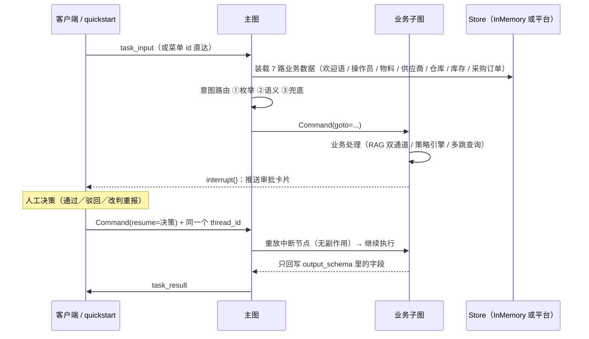

# 架构说明

这份文档写的是**模块之间**的东西：进程怎么组织、图怎么装配、契约在哪、改动时该看哪。
每个模块**内部**的设计理由不在这里重复 —— 它们写在各自文件顶部的 docstring 里
（`rag/`、`kg/`、`integrations/`、`llm/offline/` 都写得很细），本文只在必要时指路。

---

## 一、运行形态：四个入口，一套图

| 入口 | 起法 | 用的是什么 | 用途 |
|---|---|---|---|
| `quickstart.py` | `uv run --project scm_agent python quickstart.py` | `InMemorySaver` + 进程内 store | 零配置演示，17 个场景（13 个上工作台） |
| 平台服务 | `scm_agent/run_scm_agent`（`langgraph dev` :2024） | 平台运行时 + webapp 的 `/scm/*` 路由 | SSE、JWT、演示工作台 |
| 审批看板 | `scm_admin/run_scm_admin`（Flask :5000） | 读平台服务 Store 里的审批记录 | 单页只读：审批明细 + 首次通过率 |
| MCP 工具网关 | `integrations/mcp/bridge.py` 按需拉起 | stdio 子进程 | 工具解耦演示，18 个工具 |

关键点：**前两者跑的是同一个 `build_graph()`**。`demo/runner.py` 与
`webapp/chat_routes.py` 都只是「驱动同一张图 + 消费同一套进度事件」的外壳，
所以离线看到的链路与线上完全一致 —— 不存在「demo 一套、服务一套」。

`mcp_server/` 是个独立进程，只在 `TOOL_GATEWAY=mcp` 时被拉起，不参与图装配。

---

## 二、图装配的三个契约

### 1. 状态分四层，输入／输出都被收窄

`scm_state.py` 把状态拆成 `InputState` / `IntermediateInputState` /
`IntermediateOutputState` / `OutputState`，最终 `ScmState` 是四者的并集，而
`StateGraph(...)` 声明的是：

```python
StateGraph(state_schema=ScmState, input_schema=InputState, output_schema=OutputState)
```

于是**外部能传进来的只有 `task_input`，能拿走的只有 `task_result` 与
`node_result`**。中间那些装载的数据与会话内的中间产物，外部既塞不进来也读不走。
这是「统一状态模型」的安全边界：会话状态在链路内部自由流动，跨边界只有两个字段。

### 2. 子图的 `output_schema` 是一道过滤器，不是声明

**没写进子图 `output_schema` 的字段，不会回写到父图状态。** 它不会报错、
不会告警，只是安静地丢掉。所以每个 `sub_*/sub_*_state.py` 的 `OutputState`
里都留了显式注释：

```python
# ⚠️ 必须出现在 output_schema 里，否则子图结束时该字段会被丢弃。
supplier_query: Union[SupplierComparison, SupplierEvaluation]
```

拿上面这行为例：`supplier_query` 从单一模型扩成 Union 时，只改模型不改这里，
履约评估的结果就**不会**回写父图 —— 页面不报错，只是最后一步没有产出。
推论有两条：新增子图产物时**先改 `OutputState`**；子图状态里**不要放 dataclass** ——
跨检查点的数据必须是可序列化的 pydantic 模型（`models/scm_models.py`），
而纯进程内的中间量（检索片段之类）才用 dataclass（`rag/types.py`）。

### 3. `reducer_node_result`：空 list 会**清空**累积

```python
def reducer_node_result(current, update):
    if not update:
        return []          # ← 空 = 置空，不是「不变」
    return current + update
```

这个语义是给 `cleanup_state` 用的（每轮开始时清空上一轮轨迹），代价是**每个节点
都必须返回非空 `node_result`** —— 包括那些「只做一件事」的节点（各子图的 welcome
节点、`task_result_confirm`）。任何一处漏返回，本轮的执行轨迹就会从那一刻起
被清空，前端时间线看起来像「什么都没发生」。

---

## 三、一次请求的生命周期



两个容易踩的点：

* **resume 时必须重发 `configurable.user_id` / `external_id`** —— 节点直接读
  `config["configurable"]["user_id"]`，而这两个值**不从检查点恢复**（检查点存的是
  图状态，不是 config）。漏发就是 `KeyError`。
* **`interrupt()` 所在节点在 resume 时会从第一行重放**，所以中断前不得有副作用。
  这条不是靠自觉：下单、入库这些写动作被放在中断**之后**的独立节点
  （`purchase_execute` / `receipt_execute`），重放审批节点结构上就不可能重复执行；
  副作用节点内部再过一遍 `IdempotencyGuard`，双保险。

---

## 四、路由：菜单 id 是**编译期**契约

`intent_detection` 返回 `Command(goto=...)`，`goto` 的目标必须是图里**已注册的节点名**。
所以 `NodeName` 枚举的值同时扮演三个角色：

1. 图里的节点名（`scm_graph.py` 的 `add_node`）；
2. 路由目标（`Command(goto=...)`）；
3. **前端菜单 id**（工作台按钮、`demo/scenarios.py` 里的场景输入）。

三者任一改了就编译不过或路由不到。改菜单名时，`index.html` / `app.js` /
`scm_node.py` / `demo/scenarios.py` 必须同步改 —— 这是本仓库唯一一处
「改一处要改四处」的地方，刻意保留（它换来的是路由零成本：枚举命中时**不调模型**
直达子图）。`test_every_intent_value_is_a_reachable_menu_id` 是这条契约的门禁。

路由三层：① 输入恰好等于某个菜单 id → 直接跳，零成本；② 否则交给模型做语义识别
（离线时是 `llm/offline/synth_core.py` 的关键词打分）；③ 模型给出枚举外的值 →
归入通用问答兜底。

六个菜单 id：`material_qa` / `purchase_request` / `goods_receipt` /
`inventory_query` / `supplier_query` / `no_clear_intention`。

---

## 五、图谱通道：JSON 是事实源，图是投影

`src/kg/` 与 `rag/` 平行分层 —— 它被检索链路与业务子图**同时**使用，因此不归
`integrations/`：

| 文件 | 职责 |
|---|---|
| `schema.py` | `NodeKind` / `EdgeKind` / `GraphStoreUnavailable` 与节点 id 口径 |
| `store.py` | `GraphStore` Protocol + `get_graph_store()`（首次调用时投影建图） |
| `memory_store.py` | 默认实现：dict + 邻接表，零依赖 |
| `neo4j_store.py` | 可选后端；缺驱动或连不上 → warning + 回落内存 |
| `link.py` | 实体链接：编码正则直命中 + 同义词 + 名称倒排最长匹配 |
| `query.py` | 三个多跳查询 + 预设分 + `guard()`/`retrieve()`（降级入口） |

两个设计要点：

* **图没有自己的数据源**。同一批 `data/seed/*.json` 既灌 Store 也投影成图
  （当前 205 节点 / 309 边），两边不许出现第二份事实。图上的边携带属性
  （报价、库存量、安全线），查询直接读边属性渲染事实，数字天然可溯源。
* **两个消费者，一个守卫**。检索链路经 `retrieve()` 进来（内部先过 `guard()`），
  供应商履约评估经 `guard()` 直接读图 —— 熔断器（名字固定 `graph`）与
  `MOCK_FAIL_ACTIONS=graph` 的判定只在这一个函数里。否则注入一次故障，
  问答降级了、履约评估却照常给出价格竞争力，同一次故障两种口径。

检索侧的三段接线（都在 `rag/`）：**路由** `router.classify()` 判 DOC / RELATION /
BOTH（全不中落回 DOC 安全侧）→ **融合** `retriever.HybridRetriever` 在 RRF 上接
第三路，通道权重只缩放融合分、不改候选集合 → **呈现** `index.py::_keep_relation_evidence`
给关系类问题的引用清单留一个图事实位（只加位、不改序、不碰分数：词面匹配与路径
完整度是两种量纲），`answer.py` 把图事实整句照抄并排在前面。

降级分级在 `observability/degrade.py`（L0 双通道正常｜L1 图挂 → 页脚
「本次未启用图谱关联分析」｜L2 文档空 → 只用图事实｜L3 双失或置信度不足 →
转人工），`ask()` 是请求边界，上一轮的降级不带进下一轮。

---

## 六、三个横切面

### 1. 工具调用：ports 定义，两条路径实现

业务节点只认 `integrations/ports.py` 的 Protocol（8 个端口：material / supplier /
warehouse / inventory / purchase / receipt / file / handoff）。默认 `direct` 直接在
进程内调 mock/http 适配器；`mcp` 则经 `integrations/mcp/bridge.py`（stdio 子进程）
调用 `mcp_server/server.py` 暴露的 18 个工具。**字段归一只有一份**
（`integrations/normalize.py`），两条路径共用，所以切换网关不改变业务结果。

一个只在 MCP 模式下才成立的坑：网关子进程的环境变量在**启动那一刻定格**，
之后改父进程 `os.environ` 送不进去。所以场景级的故障注入（`MOCK_FAIL_ACTIONS`）
在进出场景时都要 `reset_ports()` 把网关关掉，让下一次调用拿新环境重启 ——
否则「注入图谱故障」的场景会静默跑成正常路径，而且不报任何错。

### 2. 可观测：进度事件有两个来源

节点里手写的 `emit()` 只是其一。节点没写 emit 时，`demo/runner.py` 消费
`updates` 通道并按 `observability/progress.NODE_EVENTS` 表补一条业务步骤，
判据是「刚跑完的这个节点有没有 emit 过」（custom 事件先于该节点的 update 到达）。
想给某条链路加时间线，先看那张表，别只 grep `emit(`。

前端只在 `static/app.js` 里折叠**白名单**中的阶段（目前只有 `normalize`）。

### 3. 离线模式：一个切换点，两种实现

`llm/llm_setting.py` 是真实模型与离线模型的**唯一**切换点，5 个 `llm_*.py` 调用方
零改动。判断当前是否离线要用 `is_offline_model()` 看实例 —— 填了 `LLM_MODE=live`
但缺配置会**自动回落离线**，这时环境变量是说反的。

离线合成器（`llm/offline/synth_scm.py`）按提示词里嵌入的 JSON Schema 根 `title`
分派，产出必须能通过 `model_validate` 才返回。它是**数据驱动**的：从提示词取业务
数据、用词表与正则找证据、把证据原文写进 reason。返回固定常量会让 demo 在面试官
换一句话之后立刻露馅。

---

## 七、关键取舍一览

| 决定 | 代价 | 为什么仍然这么选 |
|---|---|---|
| 检索默认纯 Python TF-IDF | 语义泛化弱于稠密向量 | clone 下来就能跑是硬约束；术语高度重合的制度语料里词法信号不吃亏。`VECTOR_STORE=milvus` 可切换，接口一致 |
| 重排分用绝对分 `x/(x+3)` | 分数不再「好看」（top1 通常 0.5~0.8） | 按查询归一化会让 top1 恒为 1.0，固定阈值失效、转人工永不触发 |
| 诉求词覆盖率只有「等于 0」判负 | 阈值不可调 | 实测可回答问题最低 0.20、判负样本 0.00，灰区（0.11–0.13）判不了，卡任何非零值都会误伤 |
| 覆盖率用**实词**口径（双字组不跨停用字） | 判据多一点预处理 | 不认「的规」这类跨词记号：它们是分词产物不是诉求，会让判负线被凑巧命中顶穿 |
| 引用清单按配额给图事实留位 | 引用位少一个给文档 | 词面匹配与路径完整度是两种量纲，分数不该互相让路，但「替代的是哪个料、哪个仓有货」不能被制度条款挤掉 |
| 同义词表人工维护 | 需要业务方干预 | 业务术语（替代料／让步接收／免审批直采）通用模型也学不好；改词不用碰检索代码 |
| `verify_no_new_numbers` 丢弃不合格输出 | 偶尔会退化成生硬的事实转述 | 编造数字是唯一可机械校验、又最会引发漏料事故的错误 |
| 幂等的「同键不同内容」抛冲突 | 需要人工介入 | 静默复用会下错单，重复执行会下两次单，两个都赌不起 |
| 离线合成器而非录制回放 | 需要为每种输出写一个合成器 | 换一句话仍然成立；回放一改输入就露馅 |
| 图谱与检索同源投影，不另建数据 | 图查询能力受制于种子表的形状 | 两处事实必然一致（比对用例直接对账两条路径），演示不会自相矛盾 |
| 前端时间线只折叠白名单阶段 | 新增啰嗦阶段要手动登记 | 「连续 ≥N 条同名就折」会折掉 `load_data` 那 7 行——那是要给人看的能力证据 |
| `.env` 与路径常量都避开 `os.getcwd` | 多一个 `utils/env_loader.py`；路径要写词法 `parents[n]` | `langgraph dev` 的 blockbuster 会拦 `os.getcwd`，而裸 `load_dotenv()` 与 `Path(...).resolve()` 内部都在调它。模块只要是「首次请求才 import」的（工作台首请求才建图），整条请求就 500——两种写法都实测踩过 |

---

## 八、文件地图：想改 X，去看 Y

| 想改的 | 去哪 |
|---|---|
| 意图与链路路由 | `graphs/scm_graph/scm_node.py`、`scm_graph.py` |
| 会话状态字段 | `graphs/scm_graph/scm_state.py` + 对应子图的 `*_state.py`（注意 output_schema） |
| 检索质量 | `rag/expansion.py`（同义词表，最常改）→ `rerank.py` → `confidence.py` |
| 知识库内容 | `data/knowledge/**/*.md`（目录名即 kind：policies / materials / faq） |
| 图谱查询与路径 | `kg/query.py`（三个多跳查询 + 预设分表）；图数据来自 `data/seed/*.json` |
| 采购／质检策略 | `data/seed/purchase_policy.json`、`quality_policy.json`（全条件 AND + priority，逐条打印判定依据） |
| 业务接口 | `integrations/ports.py` 定义 → `mock/` 与 `http/` 分别实现 → `mcp/` 网关 |
| 字段归一 | `integrations/normalize.py`（两条网关路径共用） |
| 幂等与审批 | `integrations/idempotency.py`、`integrations/policy.py`、`sub_purchase_request/`、`sub_goods_receipt/` |
| 降级与熔断 | `observability/degrade.py`（L0–L3）、`integrations/resilience.py`（熔断器） |
| 进度事件与时间线 | `observability/progress.py` 的 `NODE_EVENTS`，前端 `webapp/static/app.js` |
| 演示场景 | `demo/scenarios.py`（与工作台 `/scm/samples` 共用同一份） |
| 离线合成逻辑 | `llm/offline/synth_scm.py`（新增输出类型时在此注册） |
| 审批看板 | `scm_admin/`（单页只读，数据来自平台 Store 的 `approval` 命名空间） |
